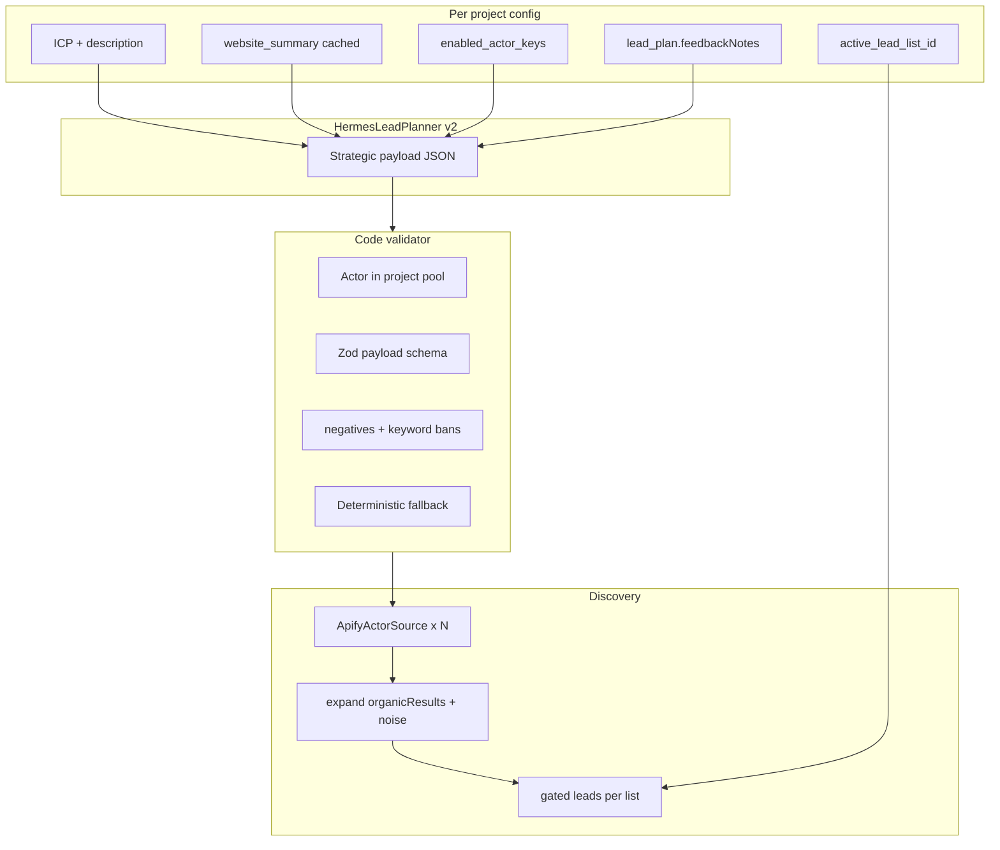

# PLAN-3: Strategic Payload Generator + Operations Console + Lead Lists

**Date:** 2026-07-11  
**Status:** Approved — ready to implement  
**Supersedes:** rigid `compile-lead-plan.ts` Google-only path for Find leads  
**Related:** [PLAN.md](./PLAN.md) (Apify V1), [PLAN-2.md](./PLAN-2.md) (enrichment), [lead-strategy design](../docs/superpowers/specs/2026-07-11-lead-strategy-design.md)

---

## Summary

Upgrade **Find leads** from fixed Google Search queries to a **per-project AI Strategic Payload Generator**:

1. Hermes outputs **actor + Apify input JSON** (not just search strings).
2. Code **validates** against each project's **enabled actor pool**.
3. **Operations Console** on the dashboard shows every behind-the-scenes artifact in **separate read-only fields** (planner input, raw Hermes output, validated payload, compiled jobs, run history).
4. **Lead Lists** inside each project — switch/create/clear/delete campaigns (e.g. 100 payment SMBs, then new empty 200 NFT list).
5. Optional **`project.website` summary** cached for smarter planning.

Phase 1 feedback: **manual Lead Plan textarea only**. Structured `scraping_feedback` DB deferred to phase 2.

---

## Decisions locked

| Decision | Choice |
|----------|--------|
| Actor selection | Per-project `enabledActorKeys` — Hermes picks only from that pool |
| Multi-project | Project A (Maps + Wellfound) vs Project B (LinkedIn + Google) — isolated |
| Feedback loop | Manual Lead Plan feedback + regenerate (no auto DB yet) |
| Website context | Fetch/summarize `project.website`, cache 7 days |
| Lead organization | **Lead lists inside project** (not one flat bucket) |
| Observability | Full Operations Console — separate fields for each payload stage |

---

## Implementation checklist

- [ ] **schema-lead-strategy** — `lead_strategy`, `website_summary`, `website_summary_at`, `active_lead_list_id` on projects; migrate DB
- [ ] **lead-lists** — `lead_lists` table; `lead_list_id` on leads, discovery_runs, feedback; APIs + UI switcher
- [ ] **actor-catalog** — `src/discovery/actor-catalog.ts`; verify Wellfound + LinkedIn Apify actor IDs via smoke runs
- [ ] **strategic-payload-schema** — Zod schema + `validate-strategic-payload.ts`
- [ ] **hermes-planner-v2** — Strategic payload jobs output; pass enabledActorKeys, website_summary, feedbackNotes
- [ ] **wire-one-click** — Replace compile path; snapshot JSON on discovery runs
- [ ] **website-summary** — `project-website-summary.ts`; refresh on create/PATCH + manual button
- [ ] **noise-source-aware** — Enforce negatives; source-aware Wellfound allow
- [ ] **ui-enabled-sources** — Multi-select enabled sources in project settings
- [ ] **dashboard-observability** — Operations Console UI + extended discovery APIs
- [ ] **tests-docs** — Tests + update `docs/apify-lead-finding.md`

---

## Problem being solved

Today [`compile-lead-plan.ts`](../src/discovery/compile-lead-plan.ts) hard-codes `apify/google-search-scraper`. Maps only runs when intents match fixed strings. Plan `negatives` are stored but **never enforced**. Result: topic Google queries return Visa, Razorpay, blogs — not agency buyers.

---

## Target architecture



**Invariant:** `generatePayload(projectId)` = `(project + actorPool + websiteSummary + leadPlan.feedbackNotes + activeList)` — never global.

---

## Phase 1 — Core engine

### 1. Actor catalog + per-project enablement

File: [`src/discovery/actor-catalog.ts`](../src/discovery/actor-catalog.ts)

| Key | Default actorId | Best for |
|-----|-----------------|----------|
| `google_maps` | `compass/crawler-google-places` | Local SMBs |
| `google_search` | `apify/google-search-scraper` | Narrow intent only |
| `wellfound_startups` | TBD (verify at build) | US startups / hiring |
| `linkedin_jobs` | TBD (verify at build) | Hiring / role-intent |

Project JSON (`lead_strategy` column):

```typescript
{
  enabledActorKeys: ["google_maps", "wellfound_startups"],
  defaultGeography: "USA" | null,
  buyerMode: "agency" | "hiring" | "custom"
}
```

- Pixel Punch default: `google_maps` + `wellfound_startups`
- UI: Project settings multi-select **Enabled lead sources**

### 2. HermesLeadPlanner v2 — Strategic Payload

File: [`src/discovery/hermes-lead-planner.ts`](../src/discovery/hermes-lead-planner.ts)

Output shape (`StrategicPayload` v1):

```typescript
{
  version: 1,
  goal: string,
  geography: string | null,
  volumeTarget: number,
  negatives: string[],
  jobs: [{
    jobId: string,
    actorKey: string,
    reasoning: string,
    apifyInput: Record<string, unknown>,
    mapping: ApifyResultMapping
  }]
}
```

Prompt rules: buyer verticals (not SEO topic strings); actorKey from enabled list only; default US hubs if geo empty; apply negatives + feedbackNotes.

Files: [`strategic-payload.ts`](../src/discovery/strategic-payload.ts), [`validate-strategic-payload.ts`](../src/discovery/validate-strategic-payload.ts)

### 3. Wire Find leads

[`compile-lead-plan.ts`](../src/discovery/compile-lead-plan.ts) → `strategicPayloadToJobs()`  
[`one-click-lead-finding.ts`](../src/discovery/one-click-lead-finding.ts): plan → validate → run

### 4. project.website summary

File: [`project-website-summary.ts`](../src/discovery/project-website-summary.ts)

- Fetch homepage on create/PATCH when website changes
- Optional Hermes 3-bullet summary
- Columns: `website_summary`, `website_summary_at`
- Refresh if missing or > 7 days on Find leads
- UI: **Refresh from website** button

### 5. Post-fetch quality

[`noise-filter.ts`](../src/discovery/noise-filter.ts): enforce negatives; reject vendor/blog domains  
Source-aware: allow Wellfound profile domains when job is `wellfound_startups`  
Keep [`expandApifyDatasetItems`](../src/discovery/map-candidate.ts) for Google organic results

---

## Operations Console (dashboard observability)

**Goal:** See everything behind Find leads — each artifact in its **own labeled field** (read-only JSON + Copy).

### Fields per discovery run

| Field | Stored in |
|-------|-----------|
| Planner input | `discovery_runs.planner_input_json` |
| Raw Hermes output | `discovery_runs.planner_raw_json` |
| Validated payload | `discovery_runs.payload_json` |
| Compiled Apify jobs | `discovery_runs.compiled_jobs_json` |
| Validation notes | `discovery_runs.validation_notes` |
| Run summary | existing run columns |
| Job table | `discovery_source_jobs` |
| Timeline | derived |
| Rejected samples (25) | `discovered_candidates` |
| Kept samples (10) | `discovered_candidates` |

### API

| Endpoint | Purpose |
|----------|---------|
| `GET /api/projects/:id/discovery/latest` | Full observability for active list's latest run |
| `GET /api/projects/:id/discovery/runs` | List last N runs |
| `GET /api/projects/:id/discovery/runs/:runId` | Full run detail |
| `GET /api/projects/:id/lead-plan` | + leadStrategy, websiteSummary, jobs preview |

### UI

- Replace thin Activity card with **Operations Console** section
- `<details>` per JSON field + Copy button
- Poll every 3s while run status = running
- Run picker dropdown (last 10 runs)
- Scoped to **active lead list**

---

## Lead Lists (campaigns within a project)

```text
Project (Pixel Punch)
  ├── List A: "Payment SMBs" — 100 leads
  ├── List B: "NFT startups" — 0 leads (active)
  └── List C: optional
```

### Schema

```sql
CREATE TABLE lead_lists (
  id INTEGER PRIMARY KEY AUTOINCREMENT,
  project_id INTEGER NOT NULL,
  name TEXT NOT NULL,
  description TEXT,
  created_at TEXT NOT NULL DEFAULT (datetime('now')),
  FOREIGN KEY (project_id) REFERENCES projects(id)
);
```

- `lead_list_id` on `leads`, `discovery_runs`, `feedback`
- `projects.active_lead_list_id`
- Auto-create `"Default"` list on project create + migrate existing projects
- Dedupe within active list only

### API

| Endpoint | Action |
|----------|--------|
| `GET .../lead-lists` | List with counts |
| `POST .../lead-lists` | Create + optionally activate |
| `PATCH .../lead-lists/:id` | Rename / description |
| `POST .../lead-lists/:id/activate` | Switch active list |
| `POST .../lead-lists/:id/clear` | Wipe leads/runs in list; keep shell |
| `DELETE .../lead-lists/:id` | Delete list + data (block if last) |

### UI bar (below project selector)

```text
[ Lead list: Payment SMBs (100) ▼ ]  [ + New list ]  [ Clear list ]  [ Delete list ]
```

---

## Multi-project example

| | Pixel Punch | Project B (hiring) |
|--|-------------|---------------------|
| enabledActorKeys | google_maps, wellfound_startups | linkedin_jobs, google_search |
| Lists | Payment SMBs, NFT startups | Default |
| Hermes jobs | Maps + Wellfound | LinkedIn + narrow Google |

---

## Files to touch

| Area | Files |
|------|--------|
| Schema | `src/db/schema.sql`, `src/db/database.ts` |
| Discovery | `actor-catalog.ts`, `strategic-payload.ts`, `validate-strategic-payload.ts`, `hermes-lead-planner.ts`, `one-click-lead-finding.ts`, `compile-lead-plan.ts`, `project-website-summary.ts`, `noise-filter.ts` |
| Leads | `lead-lists.repo.ts`, `leads.repo.ts` |
| Dashboard | `api.ts`, `index.html`, `app.js`, `styles.css` |
| Tests | validator, multi-project, list switch/clear/delete |
| Docs | `docs/apify-lead-finding.md` |

---

## Phase 2 (deferred)

- `scraping_feedback` table + auto-capture on reject
- Per-list `lead_strategy` override

---

## Success criteria

- Pixel Punch uses Maps + Wellfound (not 100% Google topic queries)
- Second project gets different payload from different enabled actors
- Vendor/media reject rate improves vs current 100-lead run
- Operations Console shows planner input, raw Hermes, validated payload, compiled jobs in **separate fields**
- Lead lists: switch/clear/delete work; List B Find leads does not touch List A
- `website_summary` visible when project has website URL

---

## Apify build-time verification

Before shipping `wellfound_startups` and `linkedin_jobs`: run real Apify smoke, record `actorId`, sample fields, lock mapping in catalog.
