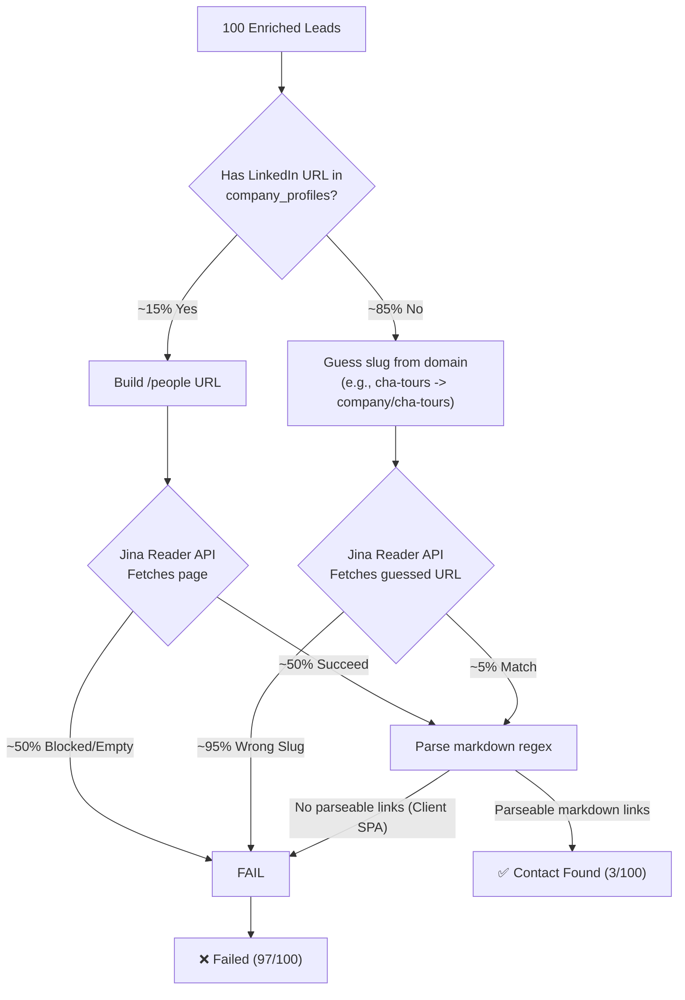

# LeadRadar & Contact Finding Upgrade Plan: Apify MCP + Dynamic Actor Architecture

## 1. Problem Analysis: Why 97 out of 100 Contact Finds Failed

The current contact-finding pipeline in [run-contact-finding.ts](file:///d:/Pixel%20Punch%20AIOS/src/contacts/run-contact-finding.ts) relies on a **single-strategy architecture** that broke across multiple single points of failure:



### Key Failure Modes
1. **Missing LinkedIn URLs**: Company enrichment (`run-company-enrichment.ts`) only checks homepages. SMBs/travel agencies rarely link their LinkedIn page from their homepage.
2. **Slug Guessing Fails**: Guessing `linkedin.com/company/<slug>` from domain names (`cha-tours.com` -> `cha-tours`) almost never matches real LinkedIn company slugs (`cha-tours-azerbaijan`).
3. **LinkedIn Bot Protection**: LinkedIn aggressively blocks Jina Reader requests (`https://r.jina.ai/https://linkedin.com/...`).
4. **Markdown Parsing Gap**: Even when Jina returns content, LinkedIn render client-side SPAs, resulting in zero `[Name - Title](https://linkedin.com/in/...)` markdown links.

---

## 2. The Two-Step Solution: Plan Creation via Apify MCP -> Execution

You are exactly right: **Hermes should discover the actors while creating the plan (`LeadPlan` / `StrategicPayload`) without executing any scraping yet.** Then, when the user (or system) triggers plan execution, our backend runs the jobs from the plan exactly as it does today.

```mermaid
sequenceDiagram
    autonumber
    actor User
    participant App as LeadRadar UI / Backend
    participant Hermes as Hermes AI Agent (`HermesLeadPlanner`)
    participant MCP as Apify MCP (`https://mcp.apify.com`)
    participant Apify as Apify Cloud Engine

    rect rgb(23, 38, 79)
    Note over User, MCP: STEP 1: PLAN CREATION (Actor Discovery without running jobs)
    User->>App: Request Lead Plan (e.g. "Tour operators in Azerbaijan")
    App->>Hermes: Call generateStrategicPayload(input)
    Hermes->>MCP: `search-actors` (query: "tripadvisor", "tourism")
    MCP-->>Hermes: Returns matching actor list
    Hermes->>MCP: `get-actor` (actorId: "apify/tripadvisor-scraper")
    MCP-->>Hermes: Returns exact JSON input schema & pricing
    Hermes-->>App: Returns `StrategicPayload` (jobs with discovered `actorId`, `apifyInput`, `mapping`)
    App->>App: Save LeadPlan to `lead_lists` (`status: draft`)
    end

    rect rgb(20, 68, 31)
    Note over User, Apify: STEP 2: PLAN EXECUTION (Running the discovered jobs)
    User->>App: Click "Find Leads" (or auto-execute approved plan)
    App->>Apify: `run-lead-finding.ts` -> `ApifyActorSource` runs jobs with exact `actorId` + `apifyInput`
    Apify-->>App: Returns candidate items -> Deduped & Saved to database
    end
```



---

## 3. Proposed Implementation Phases

### Phase 1: Connect Apify MCP to Hermes (`docker-dist/config.yaml`)
Add the Apify MCP server to Hermes' configuration so it can discover actors during plan creation:
#### [MODIFY] [config.yaml](file:///d:/Pixel%20Punch%20AIOS/docker-dist/config.yaml)
- Add under `mcp_servers`:
  ```yaml
  apify:
    url: "https://mcp.apify.com"
    headers:
      Authorization: "Bearer ${APIFY_TOKEN}"
    enabled: true
  ```
- Ensure Hermes agent environment has `APIFY_TOKEN` passed from `.env`.

---

### Phase 2: Unshackle `StrategicPayload` for Dynamic Discovered Actors
Allow `StrategicPayloadJob` to store any `actorId` discovered by Hermes during Step 1 (Plan Creation):
#### [MODIFY] [strategic-payload.ts](file:///d:/Pixel%20Punch%20AIOS/src/discovery/strategic-payload.ts)
- Update `StrategicPayloadJobSchema` to allow flexible `actorId`:
  ```typescript
  export const StrategicPayloadJobSchema = z.object({
    jobId: z.string().min(1),
    actorId: z.string().min(1), // Replaces strict `actorKey` restriction
    actorKey: z.string().optional(), // Retained for backward compatibility
    reasoning: z.string().min(1),
    apifyInput: z.record(z.string(), z.unknown()),
    mapping: MappingSchema.optional(),
  });
  ```
- Update `defaultStrategicPayload` and fallback logic to gracefully handle custom `actorId`s when `actorKey` is not in `ACTOR_CATALOG`.

#### [MODIFY] [hermes-lead-planner.ts](file:///d:/Pixel%20Punch%20AIOS/src/discovery/hermes-lead-planner.ts)
- Update `PLAN_SYSTEM` prompt:
  - Remove the rule *"Pick actorKey ONLY from the enabled list provided in the user message."*
  - Instruct Hermes: *"Use your Apify MCP tools (`search-actors`, `get-actor`) to discover the most relevant scrapers for the project's niche and geography. Output the exact `actorId` (e.g., `apify/tripadvisor-scraper`, `apify/yelp-scraper`, `compass/crawler-google-places`) along with validated `apifyInput` and field `mapping` in the jobs array. DO NOT run the actors — only output the plan."*

#### [MODIFY] [lead-finding-config.ts](file:///d:/Pixel%20Punch%20AIOS/src/discovery/lead-finding-config.ts)
- Ensure `parseSource` and `resolveLeadFindingJobs` preserve dynamic `actorId` and `mapping` directly from the strategic payload without requiring registration in `ACTOR_CATALOG`.

---

### Phase 3: Multi-Actor Contact & Enrichment Pipeline (`run-contact-finding.ts`)
Replace the broken single-strategy Jina scraper with a robust **Apify multi-scraper cascade**:
#### [MODIFY] [run-contact-finding.ts](file:///d:/Pixel%20Punch%20AIOS/src/contacts/run-contact-finding.ts)
Implement a 3-tier contact finding strategy:
1. **Tier 1: Website Contact Crawling via Apify (`apify/contact-info-scraper`)**
   - Crawls the lead's domain/website to extract direct emails, phone numbers, and social links (`LinkedIn`, `Instagram`, `Facebook`).
2. **Tier 2: LinkedIn Employees Scraper (`curious_coder/linkedin-company-employees-scraper` / `apify/linkedin-company-employees-scraper`)**
   - If a LinkedIn company URL is discovered (or via SERP search inside the actor), extract decision-makers (`fullName`, `title`, `linkedinUrl`) without requiring login cookies.
3. **Tier 3: Jina Reader Fallback (Existing)**
   - Retain existing Jina Reader markdown extraction as a lightweight fallback when Apify jobs are disabled or skipped.

---

### Phase 4: Curated Niche Actor Presets in `actor-catalog.ts`
Even though Hermes can discover actors dynamically via MCP, providing high-signal presets gives instant guidance and reliable mappings:
#### [MODIFY] [actor-catalog.ts](file:///d:/Pixel%20Punch%20AIOS/src/discovery/actor-catalog.ts)
Add verified entries for core niches:
- `tripadvisor_scraper` (`apify/tripadvisor-scraper`) — Tourism, hotels, agencies, activities.
- `yelp_scraper` (`apify/yelp-scraper`) — Local businesses, restaurants, services.
- `instagram_profiles` (`apify/instagram-profile-scraper`) — Creative agencies, D2C brands, tourism.
- `contact_info_scraper` (`apify/contact-info-scraper`) — Website contact enrichment.
- `linkedin_employees` (`curious_coder/linkedin-company-employees-scraper`) — B2B decision makers.

---

## 4. User Review & Open Questions

> [!IMPORTANT]
> **Q1: Apify Credit Usage for Contacts & Dynamic Actors**
> Using `apify/contact-info-scraper` (~$0.50 per 1,000 URLs) and `linkedin-company-employees-scraper` (~$1.00–$2.00 per 1,000 profiles/companies) will incur small pay-per-event usage on your `APIFY_TOKEN`. For 100 leads, contact finding via Apify costs roughly **$0.20 to $1.50 per run**. Is this credit budget acceptable for high-accuracy contact finding?

> [!IMPORTANT]
> **Q2: Two-Step Workflow Confirmation**
> Confirming our workflow:
> 1. **Plan Generation**: Hermes discovers actors via Apify MCP (`search-actors`, `get-actor`) and builds the `StrategicPayload` (`jobs[]`). No scraping cost incurred.
> 2. **Plan Execution**: When you click "Find Leads" (or auto-run is enabled), `run-lead-finding.ts` executes the exact `actorId` + `apifyInput` jobs defined in the plan.
> Does this two-step flow match exactly how you want it to work?

---

## 5. Verification Plan

### Automated Tests
- Run `npx vitest run tests/discovery/strategic-payload.test.ts` to verify `StrategicPayloadJobSchema` accepts flexible `actorId` without `actorKey` failures.
- Run `npx vitest run tests/contacts/` to test contact extractor logic.
- Run `npx vitest run tests/discovery/` for full discovery pipeline verification.

### Manual & E2E Verification
1. Verify `docker-dist/config.yaml` loads `apify` under `mcp_servers`.
2. Trigger "Find Leads" on a campaign focused on *Azerbaijan tourism* (`listFocus: "tour operators and hotels in Baku, Azerbaijan"`).
3. Verify Hermes uses `search-actors` / `get-actor` and outputs an `actorId` such as `apify/tripadvisor-scraper` or `google_maps` tailored to tourism inside the plan.
4. Execute the plan ("Find Leads") and verify that `run-lead-finding.ts` runs the discovered actor and saves leads.
5. Trigger "Find Contacts" on the 100 leads and verify that `contact-info-scraper` / `linkedin-employees` discovers email candidates and decision-maker profiles (`>50%` success vs `3%`).
